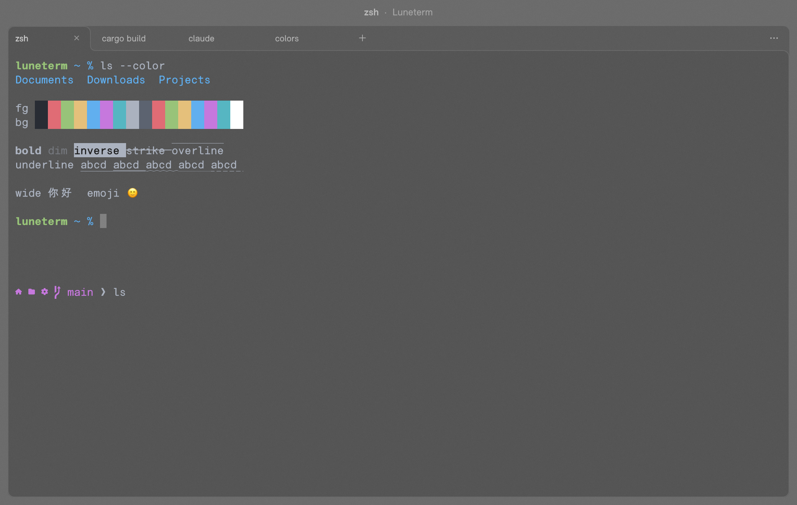
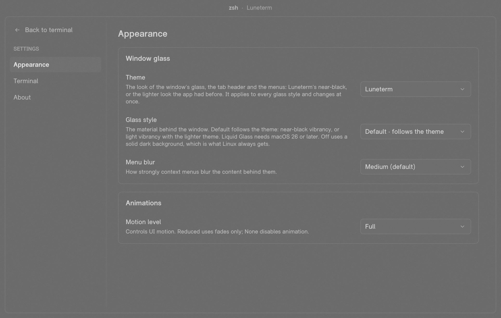
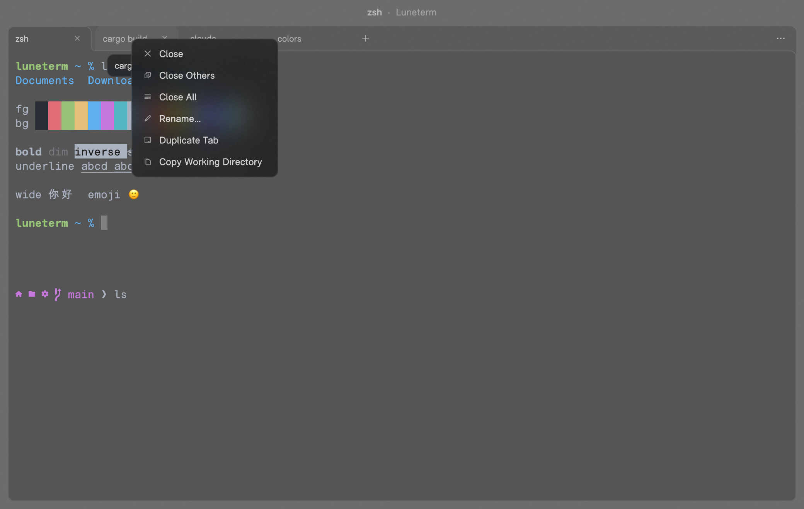

# Luneterm

A small, cross-platform terminal for Windows, macOS and Linux with a glass look, written in Rust.
Its VT engine (`lune-vt`) is a test-first port of xterm.js 6.0.0, checked against the reference
implementation with golden and differential tests. The UI is native Rust: no web engine.

Status: early (v0.2.x). It runs real shells in tabs on all three systems, but expect rough edges.



- **Glass UI** on macOS and Windows; Linux gets an opaque dark theme.
- **Own engine**: `lune-vt` has no dependencies and forbids `unsafe`. A C ABI (`luneterm-ffi`) lets
  other apps embed it.
- **Fonts**: RznMono for the terminal, RznSans for the UI (both SIL OFL), with a Nerd Font fallback.

| Settings | Tab menu |
| --- | --- |
|  |  |

The screenshots are frames the app renders offscreen with its real renderer
(`LUNETERM_DUMP_FRAMES=<dir> cargo run -p luneterm`), so they show the solid dark fallback, not the
OS glass material.

## Build and run

Needs the Rust toolchain pinned in `rust-toolchain.toml` (rustup installs it on first use).

```bash
cargo run -p luneterm            # the app
cargo build --release            # shipping profile
cargo test --workspace
```

Linux needs a Vulkan or OpenGL ES driver, `libxkbcommon` and an X11 or Wayland session.
Prebuilt, unsigned builds are attached to the GitHub releases.

## Roadmap

After the first public release the VT engine (`lune-vt`, the xterm.js port) will move to its own
repository, so other projects can use it without the terminal app.

## Layout

`crates/lune-vt` (engine), `lune-pty`, `lune-termview` (grid renderer), `luneterm` (the app),
`luneterm-ffi` (C ABI), plus conformance tests and scripts. See `docs/architecture.md` for the
layout and `docs/porting-xterm.md` for how the engine port works.

## Licence

Licensed under the [Apache License 2.0](LICENSE-APACHE). Third-party notices:
`THIRD_PARTY_NOTICES.md` and `licenses/`.
